# Generador de banners PC Factory

Aplicación local para crear banners con productos del catálogo de PC Factory y fondos y colores de campañas publicadas en Modyo. Permite generar piezas de forma individual o por lotes desde Google Sheets, editarlas y descargarlas en PNG o WebP.

## Requisitos

- Windows con Python 3 instalado y disponible mediante `py -3` o `python`.
- Un navegador moderno, como Microsoft Edge o Chrome.
- Conexión a internet para consultar campañas, catálogo, imágenes, Google Sheets y la fuente Ubuntu de Google Fonts.
- Para el modo masivo, una planilla con la estructura semanal esperada por el proyecto y acceso mediante OAuth o lectura sin iniciar sesión.

El servidor público utiliza la biblioteca estándar de Python. Para leer planillas privadas mediante OAuth, instala las dependencias con `python -m pip install -r requirements.txt`. No requiere npm ni un proceso de build.

### Planillas privadas: conectar Google por usuario

Configura una vez un proyecto de Google Cloud con Google Sheets API habilitada y un cliente OAuth de **aplicación de escritorio**. Si el equipo pertenece a la misma organización de Workspace, configura el público como Interno. Mantén la planilla Restringida y compártela con las cuentas o el grupo del equipo como Lector.

Guarda el JSON OAuth fuera del proyecto. El servidor busca `credentials.json` en `%LOCALAPPDATA%\PCFactoryBanners`, o un único archivo `client_secret_*.apps.googleusercontent.com.json` en el Escritorio del usuario. También puedes indicar una ruta explícita en PowerShell antes de iniciar el servidor:

```powershell
$env:BANNERS_GOOGLE_CLIENT = 'C:\ruta\fuera-del-proyecto\credentials.json'
python servidor-mvp.py --open
```

En **Masivo desde Google Sheets**, pulsa **Conectar con Google** y completa la autorización en el navegador con una cuenta que tenga acceso a la planilla. Después carga la semana. La conexión solicita solo lectura de Sheets; puede leer las planillas accesibles a esa cuenta, aunque el generador consulta únicamente el ID introducido.

Cada integrante autoriza su cuenta en su equipo. El token se guarda en `%LOCALAPPDATA%\PCFactoryBanners\google-token.json`, fuera de la carpeta servida por HTTP. No compartas ni subas ese token a Git. **Desconectar Google** elimina la autorización guardada localmente; para revocar también el permiso en Google, retira el acceso desde la configuración de seguridad de tu cuenta.

Sin una cuenta conectada se conserva la lectura anónima para planillas compartidas mediante enlace. Con una cuenta conectada se utiliza Google Sheets API, sin volver silenciosamente al acceso anónimo si falla la autorización.

## Iniciar en local

1. Abre la carpeta del proyecto.
2. Ejecuta **`iniciar-mvp.cmd`** con doble clic.
3. El lanzador inicia Python y abre el navegador. Si no se abre, entra en:

   **http://127.0.0.1:8765/mvp.html**

Mantén abierta la ventana del servidor mientras uses la aplicación. Para detenerlo, pulsa **Ctrl+C** en esa ventana.

También puedes iniciarlo desde PowerShell, situado en la carpeta del proyecto:

```powershell
py -3 servidor-mvp.py --open
```

Si utilizas el comando `python`:

```powershell
python servidor-mvp.py --open
```

El servidor escucha en `127.0.0.1:8765`, accesible desde el mismo equipo. Abre siempre la aplicación mediante esa dirección: abrir `mvp.html` con doble clic o usar un servidor estático genérico no proporciona las rutas de consulta que necesita el generador.

## Generación individual

### 1. Elegir el modo

El generador tiene dos modos: **Individual**, para trabajar con uno a tres productos, y **Masivo desde Google Sheets**, para generar grupos desde una planilla. Para este primer recorrido, elige **Individual**.

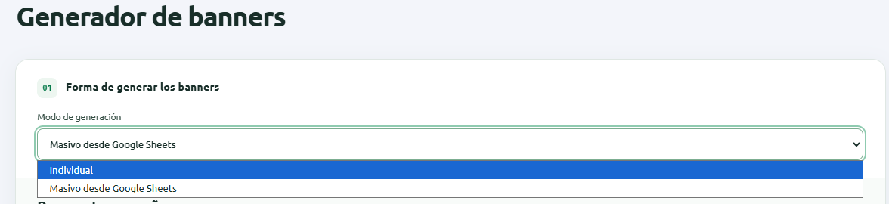

### 2. Seleccionar la campaña de Modyo

El selector muestra las campañas publicadas disponibles. Elige la que dará los fondos y colores a tus banners. Los nombres de las capturas son ejemplos; el listado cambia según las entradas publicadas.

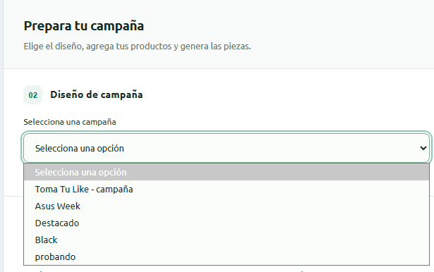

Las campañas se administran en Modyo, en el espacio **Banners principales → Entradas**, con el tipo **Campaña**. Para preparar una campaña, crea o edita su entrada, configura sus colores y carga los fondos de los formatos que utilizarás. Publica la entrada y recarga el generador para que aparezca o para obtener sus cambios.

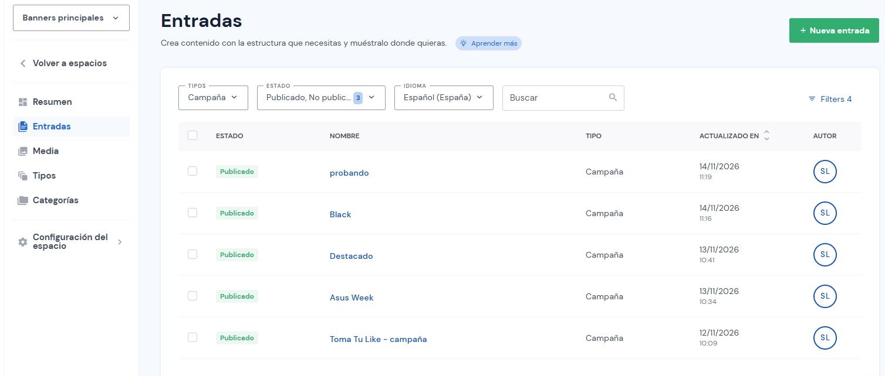

Los campos de color permiten personalizar título, nombre, precio y descuento. Un campo vacío conserva el color original del formato.

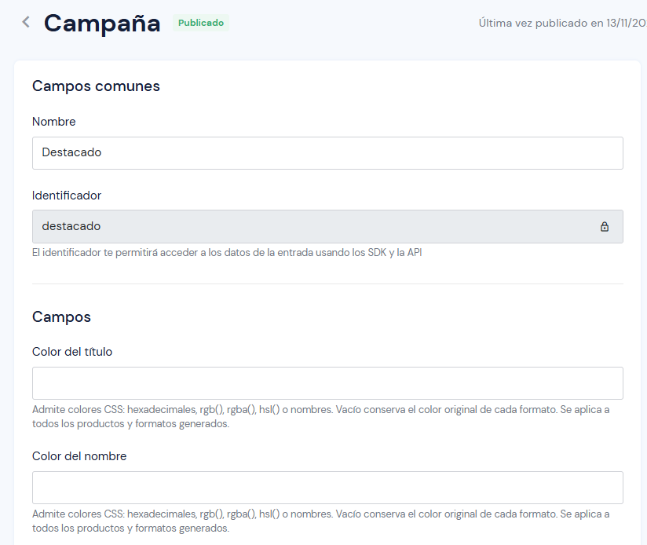

Carga el fondo correspondiente a cada formato. Desk tiene fondos independientes para uno, dos y tres productos; los otros formatos tienen sus propios recursos. Usa fondos sin portaprecios incorporados, ya que el generador los dibuja encima.

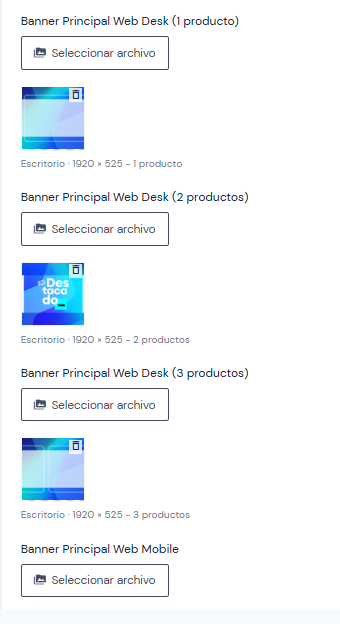

### 3. Ingresar los productos

Completa entre uno y tres IDs del catálogo. Deja vacíos los campos opcionales que no necesites. El orden de los campos completados define el orden de los productos y la cantidad determina la composición de escritorio.

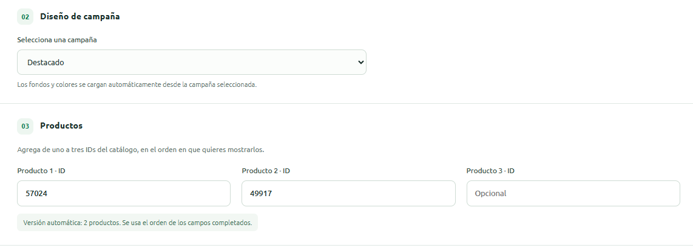

### 4. Elegir los formatos y generar

Marca las piezas que necesitas, selecciona **PNG** o **WebP** y pulsa **Generar banners**. Debes seleccionar al menos un formato.

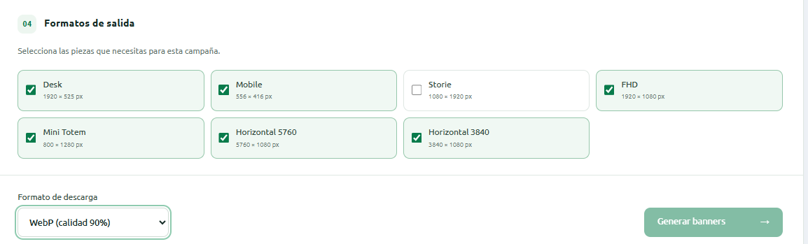

### 5. Revisar y personalizar

Al terminar, encontrarás las piezas en **Vista previa y descarga**. Desk reúne los productos; los demás formatos muestran una pieza por producto.

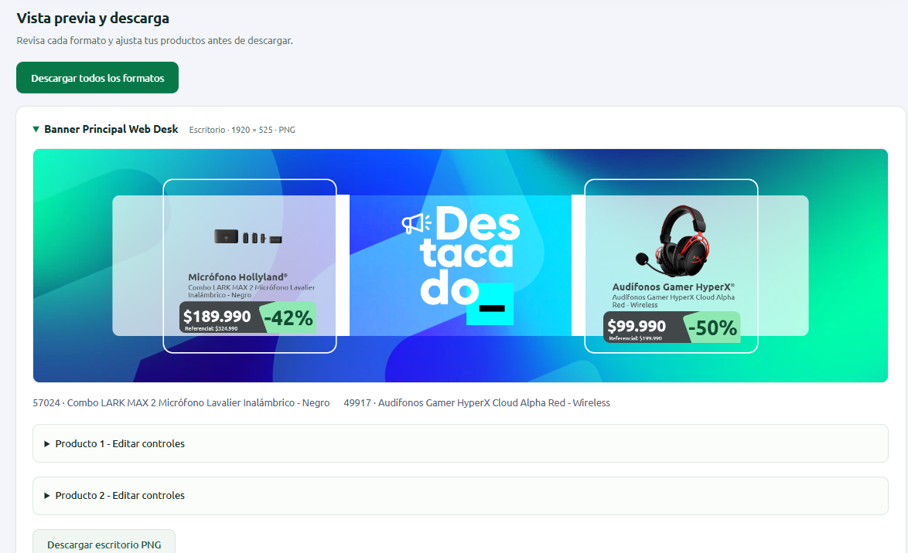

Abre **Producto 1 - Editar controles** o el panel del producto correspondiente. Puedes editar título, nombre, precio, referencial e imagen, además de ajustar el tamaño de la imagen con el zoom y moverla con los ejes X e Y. Las opciones de eliminación de blancos corresponden a las fotos del catálogo.

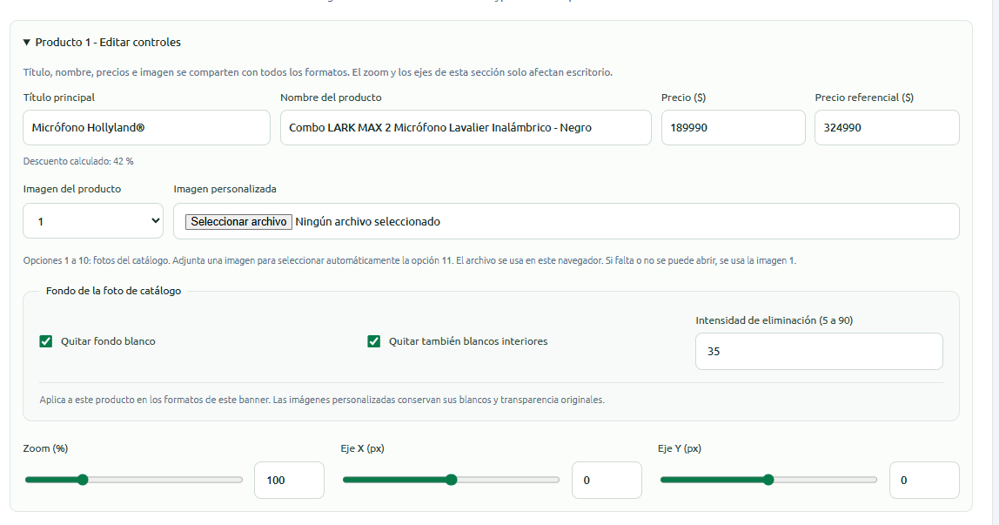

Para usar tu propia imagen, pulsa **Seleccionar archivo** en **Imagen personalizada**. Se seleccionará automáticamente **11 - Personalizada**. El ejemplo cambia la foto por un cuaderno y edita el título; el nombre y los precios conservan sus valores hasta que los cambies también.

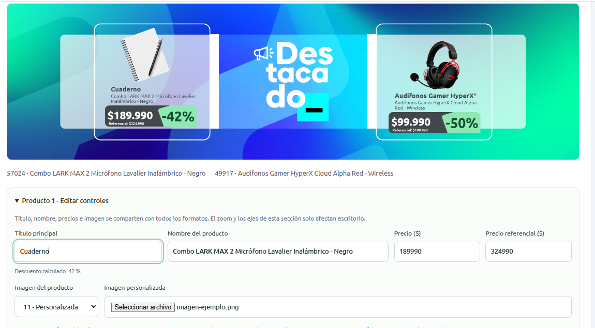

La imagen elegida, los textos y los precios se comparten con los demás formatos generados del mismo producto. Ajusta el zoom y la posición en los controles de cada formato si necesitas mejorar el encuadre.

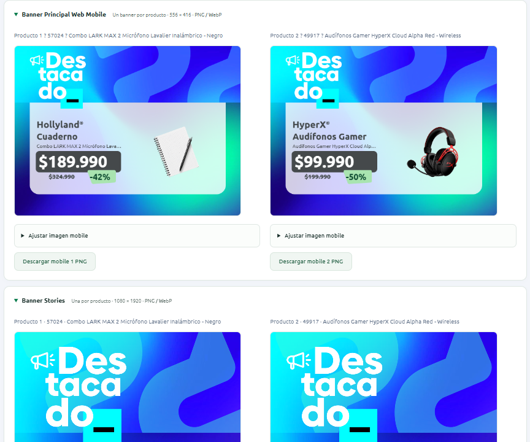

### 6. Descargar las piezas

Pulsa **Descargar todos los formatos** para descargar las piezas generadas del banner actual. Se descargan como archivos separados; si el navegador solicita permiso para varias descargas, habilítalo para el sitio local.

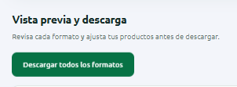

También puedes usar el botón de una pieza para descargar únicamente esa imagen. La extensión depende del selector PNG/WebP.

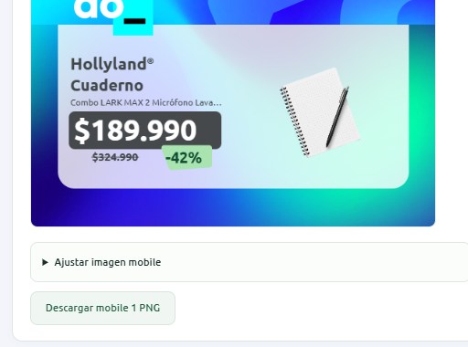

### Resumen del flujo

1. Selecciona el modo **Individual**.
2. Elige una campaña. Sus fondos y colores se cargan desde Modyo.
3. Introduce entre uno y tres IDs numéricos del catálogo. Deja vacíos los campos que no necesites; el orden de los IDs determina el orden de los productos.
4. Marca al menos un formato de salida.
5. Elige **PNG** o **WebP** y pulsa **Generar banners**.
6. Revisa las vistas previas y ajusta textos, precios, imagen, zoom y posición.
7. Usa los botones de descarga de cada pieza.

Desk reúne los productos en una composición simple, doble o triple. Los otros formatos generan una pieza por producto.

### Edición e imágenes

- Los textos y precios se comparten entre los formatos del mismo producto; los controles de zoom y posición permiten ajustar cada formato.
- El título inicial se construye con familia y marca. Para determinadas familias también reconoce características del nombre, como IdeaPad, Gamer, Portátil o Curvo.
- El descuento se calcula a partir del precio efectivo y el referencial. Solo aparece cuando el referencial es mayor que el efectivo y mayor que cero.
- Puedes alternar las imágenes del catálogo o adjuntar una imagen propia. Adjuntar un archivo selecciona automáticamente la opción **11** y conserva sus blancos y transparencia.
- El adjunto se procesa en el navegador: no se sube a Modyo ni se guarda al recargar. Cambiar el ID del producto limpia el adjunto; si el archivo no se puede decodificar, se vuelve a la imagen 1.
- Al regenerar el mismo ID se conservan los textos y precios editados durante la sesión.

Puedes hacer clic en una vista previa, o clic derecho → **Abrir enlace en una pestaña nueva**, para verla como imagen. Estos enlaces Blob son temporales y no sirven como URLs públicas permanentes.

## Generación masiva desde Google Sheets

### 1. Cambiar al modo Masivo

Selecciona **Masivo desde Google Sheets**. En este modo aparecen los controles de Google, el enlace de la planilla y los selectores de semana y ciclo. Cada grupo obtiene su campaña desde la planilla.

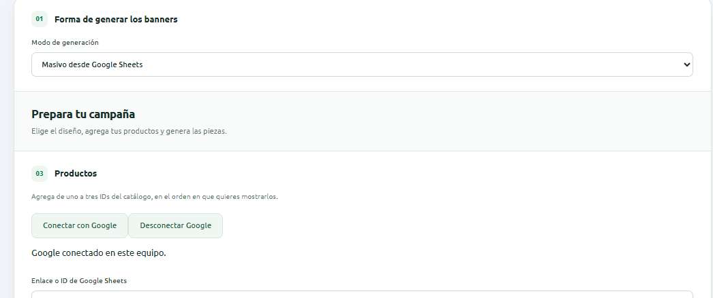

### 2. Conectar con Google

Con la configuración OAuth preparada según la sección de requisitos, pulsa **Conectar con Google**. Utiliza una cuenta con acceso de lectura a la planilla privada.

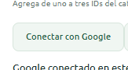

Se abrirá Google para iniciar sesión y autorizar a **Generador de banners PC Factory**. Revisa el permiso y continúa: se solicita lectura de las hojas de cálculo accesibles a tu cuenta. Esto permite leer la planilla privada sin publicarla.

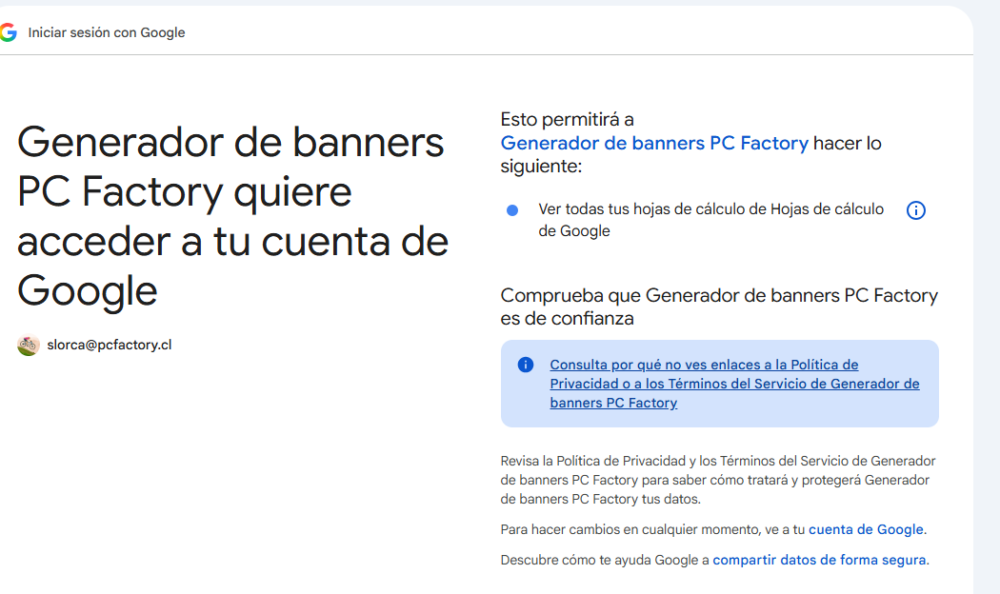

Cuando aparezca **The authentication flow has completed. You may close this window**, puedes cerrar esa pestaña y volver al generador. La aplicación mostrará que Google está conectado en el equipo.

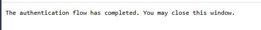

### 3. Elegir la planilla, la semana y el ciclo

Revisa el campo **Enlace o ID de Google Sheets**: puedes usar la planilla precargada o reemplazarla por otra compatible. Selecciona una semana de **W01 a W52** y pulsa **Cargar / actualizar semana**. La hoja debe existir con ese nombre; el `gid` del enlace no reemplaza la selección semanal.

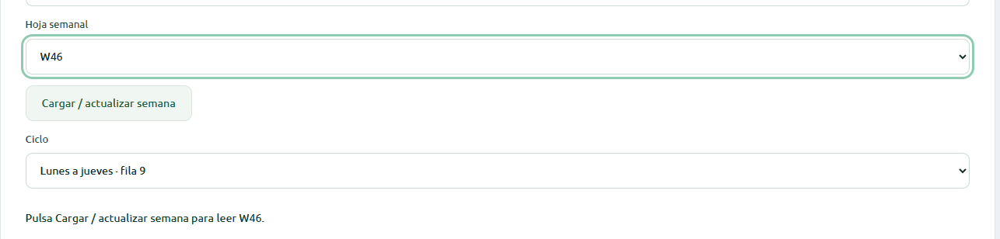

Elige el ciclo que vas a generar: **Lunes a jueves · fila 9** o **Viernes a domingo · fila 43**. Revisa las tarjetas de los grupos cargados y corrige los datos que aparezcan por revisar.

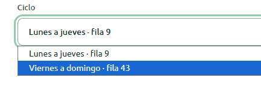

### 4. Elegir formatos y generar el lote

Selecciona los formatos necesarios. Cambiar los controles generales los aplica a todos los grupos; también puedes elegir formatos específicos en la tarjeta de cada banner.

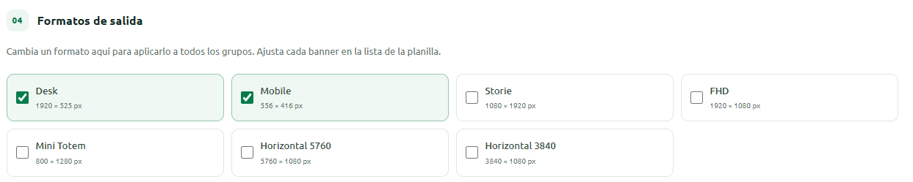

Pulsa **Generar banners** y espera a que termine el proceso.

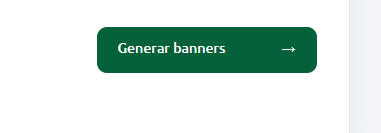

### 5. Revisar los resultados y descargar

Los resultados se organizan en pestañas por grupo. El resumen indica cuántos se generaron y cuántos tuvieron errores. Abre una pestaña marcada **Error** para revisar la causa; los grupos generados correctamente siguen disponibles.

El control **Usar precios de planilla** permite alternar con los precios del catálogo cuando hay precios válidos cargados. **Descargar todos los formatos** descarga las piezas del grupo abierto.

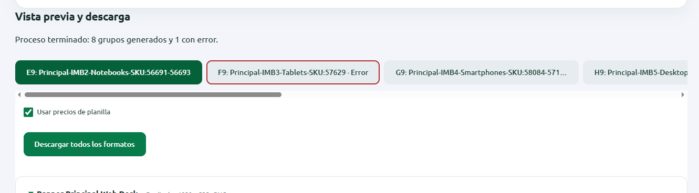

Dentro de cada grupo puedes revisar las piezas y usar los mismos controles de edición y descarga del modo Individual.

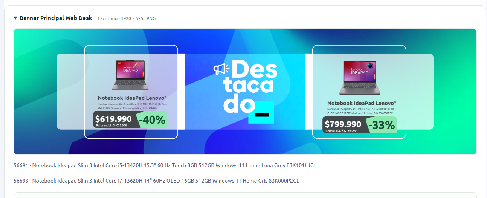

### Resumen del flujo

1. Selecciona **Masivo desde Google Sheets**.
2. Usa el enlace precargado o introduce el enlace o ID de una planilla compatible.
3. Elige la hoja semanal, de **W01 a W52**, antes de pulsar **Cargar / actualizar semana**.
4. Selecciona el ciclo:
   - **Lunes a jueves**, con referencia en la fila 9.
   - **Viernes a domingo**, con referencia en la fila 43.
5. Revisa las tarjetas: nombre del banner, IDs, campaña, celda de referencia y estado.
6. Elige los formatos. Los controles generales los aplican a todos los grupos; cada tarjeta permite ajustarlos por banner.
7. Corrige los errores de IDs en la planilla y vuelve a cargarla. Los grupos sin campaña válida o sin formatos se omiten.
8. Pulsa **Generar banners** y revisa las pestañas de resultados para editar y descargar las piezas.

Cada banner toma su propia campaña de la planilla; no necesitas seleccionar una campaña en Individual. El concepto se cruza con el UUID, slug o nombre de las campañas cargadas desde Modyo y debe identificar una única campaña.

Cuando la planilla contiene precios válidos para un grupo, se aplican inicialmente. El control **Usar precios de planilla** permite alternar con los precios del catálogo. Si los precios de la planilla no son válidos, se muestra una advertencia y se utilizan los del catálogo.

La carga obtiene diez filas de la semana seleccionada, sin descargar el Excel completo: con OAuth utiliza una consulta agrupada a Sheets API; sin conexión utiliza consultas públicas en paralelo. Puede tardar: el servidor espera hasta 120 segundos por consulta y el navegador hasta 150 segundos. Cambiar de semana limpia el lote y requiere cargarla de nuevo.

Este modo depende de la estructura de la planilla del proyecto; no importa automáticamente cualquier tabla de Google Sheets. Para una planilla privada utiliza la conexión Google descrita arriba.

## Formatos disponibles

| Formato | Dimensiones | Composición |
| --- | --- | --- |
| Desk | 1920 × 525 px | De uno a tres productos |
| Mobile | 556 × 416 px | Por producto |
| Storie | 1080 × 1920 px | Por producto |
| FHD | 1920 × 1080 px | Por producto |
| Mini Totem | 800 × 1280 px | Por producto |
| Horizontal 5760 | 5760 × 1080 px | Por producto |
| Horizontal 3840 | 3840 × 1080 px | Por producto |

Las descargas usan PNG sin pérdida o WebP con calidad del 90 %. Solo se generan los formatos seleccionados.

## Cómo funciona

El navegador carga la interfaz desde Python. El servidor consulta los servicios externos y entrega los datos al generador; el navegador compone las piezas con Canvas 2D y exporta las imágenes.

| Ruta local | Función |
| --- | --- |
| `/api/campaigns` | Lista las campañas publicadas del espacio `banners-principales`, tipo `campana`, en español, recorriendo la paginación. |
| `/api/campaigns/<uuid>` | Obtiene el detalle de una campaña del mismo origen fijo. |
| `/api/products` | Consulta entre uno y tres IDs del catálogo de PC Factory. |
| `/api/image` | Actúa como proxy para imágenes de los dominios y rutas autorizados de PC Factory. |
| `/api/sheets` | Obtiene las filas necesarias de una hoja semanal de Google Sheets. |

El selector de campañas se construye al cargar la página. Para incorporar una campaña nueva, publica una entrada del mismo tipo en Modyo y recarga la aplicación. No hay actualización automática en segundo plano.

Los fondos deben estar limpios, sin portaprecios incorporados: el generador superpone sus SVG. Mini Totem conserva por ahora su caja de precio dibujada por código. Los recursos remotos deben permitir su uso en Canvas y la exportación mediante CORS.

## Archivos principales

| Archivo | Función |
| --- | --- |
| `iniciar-mvp.cmd` | Lanzador para Windows. |
| `servidor-mvp.py` | Servidor HTTP y consultas a servicios externos. |
| `mvp.html` | Interfaz y formatos disponibles. |
| `mvp-local.js` | Carga dinámica de campañas e inicio del generador. |
| `mvp-local-generator.js` | Edición, composición Canvas y exportación. |
| `mvp-local.css` | Estilos del generador. |
| `mvp-batch.js` / `mvp-batch.css` | Flujo y estilos del modo masivo. |
| `planilla_banners.py` | Interpretación de grupos, campañas y precios de la planilla. |
| `ejemplos de banners/` | Referencias visuales, fondos y portaprecios. |
| `contexto-banners-modyo.md` | Historial de decisiones, validaciones y pendientes. |

## Problemas frecuentes

| Síntoma | Qué revisar |
| --- | --- |
| No se encuentra Python | Instala Python 3 y comprueba `py -3 --version` o `python --version`. |
| La dirección local no abre | Comprueba que el servidor siga ejecutándose y que utilizas el puerto 8765. |
| El puerto ya está en uso | Revisa si ya hay otra instancia del servidor abierta; detén la anterior antes de iniciar otra. |
| Aparecen campañas antiguas o «Cargando campaña 4/5» | Detén el servidor, ejecuta `iniciar-mvp.cmd` desde esta carpeta y recarga con **Ctrl+F5**. |
| Fallan campañas, productos o imágenes | Revisa internet y el mensaje de error de la aplicación y de la terminal del servidor. |
| Google rechaza la planilla | Si es privada, conecta con Google usando una cuenta con acceso y verifica que Sheets API esté habilitada. Si usas lectura anónima, comprueba los permisos de enlace y descarga. |
| Un grupo no encuentra campaña | Revisa la celda indicada: debe coincidir con una campaña publicada del catálogo cargado. |
| La exportación falla con un fondo remoto | Comprueba que el recurso permite CORS para su uso en Canvas. |
| No aparecen los últimos cambios | Reinicia Python si cambió el servidor y recarga con **Ctrl+F5**; vuelve a generar las piezas. |

## Comprobaciones de desarrollo

Desde la carpeta del proyecto, con Python disponible como `python`:

```powershell
python test_planilla_banners.py
python test_google_sheets_auth.py
python test_banners_browser.py
```

La prueba de navegador utiliza servicios simulados y requiere Microsoft Edge en la ruta configurada en `test_banners_browser.py`. No comprueba la disponibilidad real de Google, Modyo ni PC Factory.

Si tienes Node.js y Git, también puedes comprobar sintaxis JavaScript y espacios en las diferencias:

```powershell
node --check mvp-local-generator.js
node --check mvp-local.js
node --check mvp-batch.js
git diff --check
```

## Alcance local

La aplicación descarga archivos en el equipo. No publica banners en Modyo, no almacena imágenes de forma permanente y no genera piezas en segundo plano. Los cambios del generador local deben trasladarse y validarse por separado en el widget del CMS.
